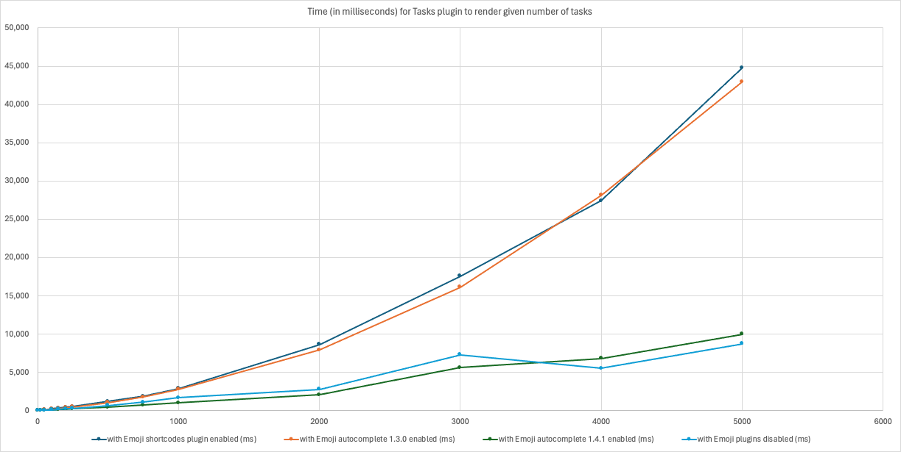

# Obsidian Emoji Autocomplete 
 

  
> Easily insert emoji by their [shortcodes](https://emojibase.dev/shortcodes/)  
   
✨ This plugin was featured on [Obsidian Addict](https://obsidianaddict.com/article/emoji-autocomplete/), in [several](https://obsidianaddict.com/article/helpful-plugins/) [articles](https://obsidianaddict.com/article/trending-plugins-20240115/) - Thank you!  
    
## Features
- Get **autocomplete/typeahead suggestions** for emoji
- **Highlight matched part** of suggestion (optional)
- Consider **emoji history** in suggestions (optional)
- Supports searching by **emoji tags** (optional)
  - typing `shuffle` will find 🔀 (twisted_rightwards_arrow)
  - Show original shortcode inline when an emoji is found by tag (optional)
- **Hide OS unsupported emoji** (optional)
- **Immediately replace emoji** / keep as shortcode & show in preview mode
- **Use text style for ©, ®, and ™** (enabled by default; optional)
- **Remove diacritics** when searching for an emoji (optional)
- **Replace flag emoji** with nicer font (optional)
- **Improved performance over [Emoji Shortcodes](https://github.com/phibr0/obsidian-emoji-shortcodes)** - [more information](#performance-improvements)
- Uses the [gemoji](https://github.com/wooorm/gemoji) library to always have an up-to-date list of emoji
- Uses the [uFuzzy](https://github.com/leeoniya/uFuzzy) library and a [custom sorting algorithm](https://github.com/KraXen72/obsidian-emoji-autocomplete/blob/master/src/main.ts#L148) for better fuzzy search suggestions

    
**Example**  
  

    

  
- `:joy:` will become 😂  
- `:heart:` will become ❤  
  
## Disclaimers
- **This plugin is incompatible** with [Emoji Shortcodes](https://github.com/phibr0/obsidian-emoji-shortcodes) (this is a full replacement) and [Icon Shortcodes](https://github.com/aidenlx/obsidian-icon-shortcodes)

## How to install
1. Go to **Community Plugins** in your [Obsidian](https://www.obsidian.md) Settings and **disable** Safe Mode
2. Click on **Browse** and search for "Emoji Autocomplete"
3. Click install
4. Toggle the Plugin on in the **Community Plugins** Tab
  
## How to install (from source)
1. `git clone` it into `<your vault>/.obsidian/plugins`
2. `npm i` or `pnpm i` (ideal)
3. `npm run dev` or `pnpm dev` (ideal)
4. Turn the plugin on inside of Obsidian

For a one-off development build, run `pnpm build:dev`. Both development commands
copy the plugin into `/mnt/c/Blackhole` (WSL) or `/media/win/#blackhole` (Linux),
when that vault exists. Set `OBSIDIAN_VAULT=/path/to/vault` to use another vault,
or `OBSIDIAN_VAULT=''` to build without copying. Reload Emoji Autocomplete in
Obsidian after building, or use the Hot Reload plugin with `pnpm dev`.

## Support plugin development
If you find this Plugin helpful, consider it's further development or just say a small thank you

#### Support KraXen72
Creator of Emoji Autocomplete and all the features on top of Emoji Shortcodes  
  
 

#### Support phibr0
Creator of [Emoji Shortcodes](https://github.com/phibr0/obsidian-emoji-shortcodes), the plugin Emoji Autocomplete was initially based on  
  

## Credits
Thanks to [@claremacrae](https://github.com/claremacrae) for rigorous testing of this plugin, which led to a significant performance improvements.
libraries / packages that were used but modified or otherwise embedded (not in package.json)
- `is-emoji-supported` modified the canvas with `willReadFrequently: true` and custom cache handling
- `country-flag-emoji-polyfill` took the font and wrote custom applying logic
- `lucide` icon pack and `icones.js.org` for several nice svg icons

## Performance Improvements
Emoji shortcodes has an issue where it slows down the [Tasks](https://github.com/obsidian-tasks-group/obsidian-tasks) and [Dataview](https://github.com/blacksmithgu/obsidian-dataview) plugins by a huge amount.  
(You can check the progress on the issue in in [this issue](https://github.com/phibr0/obsidian-emoji-shortcodes/issues/47))  
  
*credit: @claremacrae 03/2024*

Shortcode rendering uses `textContent` to avoid forced layout, indexed emoji lookups, and one pass through the DOM. Unchanged text nodes are left untouched. Run `pnpm test` to check these performance safeguards, cached font detection, and the suggestion result limit; release builds run these tests too.

## Twemoji Windows font

[Twemoji Windows](https://gitlab.com/minecraftpiston/twemoji-ttf-windows) provides a font with fixes for keycaps and combined emoji in Windows/Chromium apps. Install the TTF from its [latest release](https://gitlab.com/minecraftpiston/twemoji-ttf-windows/-/releases/permalink/latest), add **Twemoji Windows** after your text font in Obsidian, then use **Clear & Re-check** in this plugin's settings.
